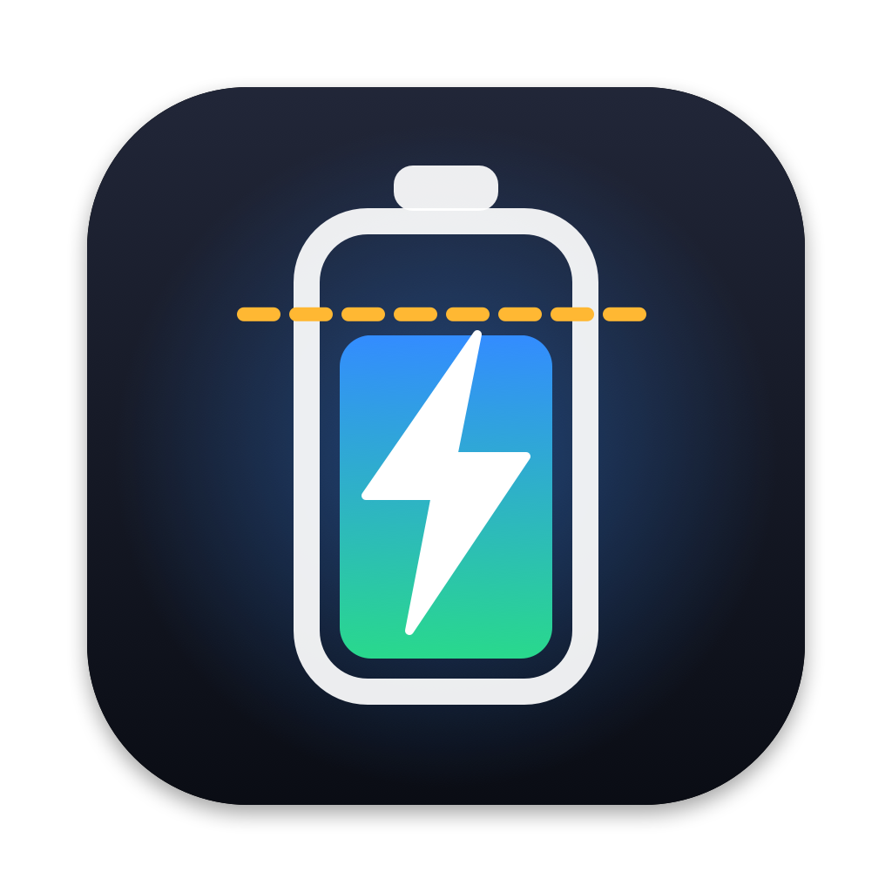

<p align="center"></p>

<h1 align="center">XCharge</h1>
<p align="center">A free, source-available battery charge limiter for Apple Silicon MacBooks.<br>Charge limit, discharge, top up and calibration, all from the menu bar.</p>

---

## Why
Keeping a lithium battery at 100% all day wears it out faster. XCharge stops charging at the limit you choose (for example 70–80%) while the Mac keeps running from the charger. You get the main features of paid apps like AlDente Pro, for free.

## Features
- **Charge limit** (20–100%) with a sailing range, so it doesn't top up on every 1% drop
- **Discharge**: run on battery while plugged in, down to your limit
- **Top Up**: charge to 100% once (e.g. before a trip); turns off when you unplug
- **Calibration mode**: 100% → 10% → 100% → hold → back to your limit, so the battery gauge re-learns its real capacity
- **Stop charging while asleep**: closes the "limit ignored overnight" gap
- **Stay awake until the limit is reached**, **heat protection**, **auto-discharge** above the limit
- Turn **macOS Optimized Battery Charging** off from the panel (it conflicts with any limit)
- Live menu bar icon: charge level, limit line, charging bolt, and the percent
- Battery health, cycle count, temperature and power draw (watts)
- In-app updates from this repo

## Requirements
- Apple Silicon Mac (M1/M2/M3/M4…) on macOS 14 or later. Built and tested on an M2 Pro with macOS 26.
- Xcode Command Line Tools (`xcode-select --install`). XCharge is built on your Mac from source.
- Quit AlDente or any other charge limiter first. Two apps writing the same SMC keys will fight; the installer offers to stop AlDente.

## Install
```bash
git clone https://github.com/ISMAIL-debug-ctrl/xcharge.git
cd xcharge
./install.sh
```
The installer asks for your password once, to install the small root helper that talks to the battery controller.

## Update
Click **Update now** in the panel when it appears, or run `./update.sh`. Your password is only asked again when the helper itself changed.

## Uninstall
```bash
./uninstall.sh
```
This restores normal charging and removes everything.

## How it works
- **Menu bar app** (SwiftUI, runs as you): the panel and settings. It writes `settings.json` and `command.json` to your own `~/Library/Application Support/XCharge` (mode 700).
- **Helper** (`/Library/PrivilegedHelperTools/com.ismailx.xcharge.daemon`, runs as root via launchd): reads the battery from IOKit and writes only two SMC keys:
  - `CHTE`: charge inhibit (charging stops, the Mac keeps running on the charger)
  - `CHIE`: adapter off (runs on battery while plugged in, used by Discharge)
- When the helper stops, it restores normal charging.

## Security
The helper runs as root, so it is built to give nothing away:
- **Root never writes where a normal user can write.** Its status and state live in root-owned `/Library/Application Support/XCharge` (0755). If that path is ever a symlink, or isn't owned by root, the helper moves it aside instead of writing through it.
- **It only reads input from the logged-in user**, from that user's own folder. It refuses symlinks, FIFOs and devices, files owned by anyone else, and files over 64 KB. Every value is clamped to a safe range.
- **Commands can't be replayed.** Each command has a unique ID and a timestamp; repeats and anything older than 60 s are ignored.
- **The helper only touches two fixed SMC keys.** It never runs shell commands, never loads plugins, and has no network access. It is signed with the hardened runtime.
- **Updates only install published releases** (`v*` tags on `main`), never every commit. The password prompt only appears when the helper itself changed. The installer copies the helper into root's private temp folder and checks its SHA-256 there, so nothing can swap it after you type your password.
- v1.0–1.2 kept files in world-writable `/Users/Shared/XCharge`, which a local program could have abused. 1.3 removes that folder safely on first start. **Please update.**

Found a security issue? Please open a GitHub issue or contact the maintainer privately before sharing details.

## Disclaimer
XCharge writes to your Mac's System Management Controller. It uses the same keys as other well-known charge limiters, but it comes with **no warranty**. Use at your own risk.

## License
[PolyForm Noncommercial 1.0.0](LICENSE). XCharge is free, and must stay free.
- ✅ Use it, modify it, and share it with anyone, at no cost
- ❌ Don't sell it, and don't put it in a paid product or service

We made this to help people stop paying for a battery limit.
